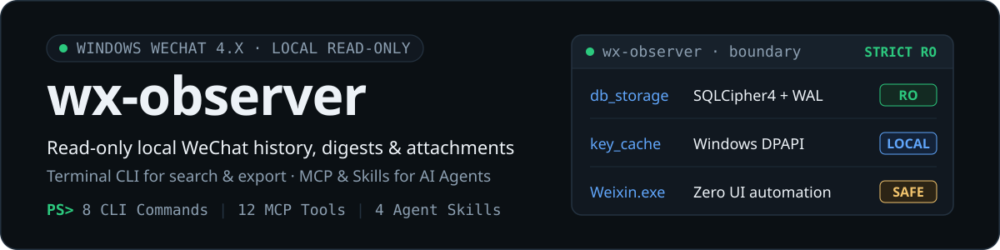
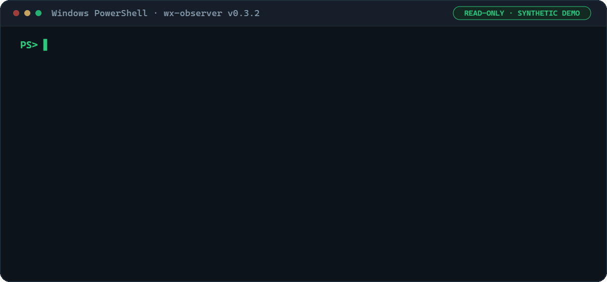

<p align="center">
  
</p>

<p align="center">
  <strong>English</strong> · <a href="./README.zh-CN.md">简体中文</a> &nbsp;|&nbsp;
  <a href="#demo">Demo</a> ·
  <a href="#quick-start">Quick Start</a> ·
  <a href="./docs/en/guide.md">Docs</a> ·
  <a href="./docs/en/architecture.md">Architecture</a>
</p>

A strictly read-only local message history extractor and real-time observer for **Windows WeChat 4.x (`Weixin.exe`)**. Search and export conversations in your terminal, or let AI agents read bounded digests, local attachments, and live message streams via MCP and Agent Skills.

## Demo

<p align="center">
  
</p>

<p align="center">
  <sub>Synthetic data demo showing <code>digest</code> (cross-chat summary + local attachment path), <code>search --compact</code>, and <code>mcp --transport stdio</code>. Prefer a still image? View the <a href="./assets/readme/terminal-demo.svg">static SVG fallback</a>.</sub>
</p>

## Highlights

- **Strict Read-Only Boundary** — Reads SQLCipher4 + `-wal` snapshots via DPAPI-cached keys without sending messages, automating UI, or injecting into `Weixin.exe`.
- **CLI Search & Multi-Format Export** — Query cross-shard history, verify downloaded attachments (including forwarded records), and export to Markdown, CSV, JSON, or JSONL.
- **Agent-Native MCP Server** — Optional `[mcp]` extra exposes 12 read-only tools over `stdio` or localhost Streamable HTTP with token budgets, compact defaults, and idempotent `peek`/`ack` cursors.
- **Built-In Agent Skills** — Includes four workflow guides under [`skills/`](skills/): [`wx-brief`](skills/wx-brief/SKILL.md), [`wx-find`](skills/wx-find/SKILL.md), [`wx-todo`](skills/wx-todo/SKILL.md), and [`wx-watch`](skills/wx-watch/SKILL.md).

## Quick Start

Requires **64-bit Windows 10 / 11**, **64-bit Python 3.11+**, and desktop **WeChat 4.x (`Weixin.exe`)** running under the same Windows user and privilege level:

```powershell
python -m venv .venv
.\.venv\Scripts\python.exe -m pip install -e .
.\.venv\Scripts\wx-observer.exe --help
```

To enable the MCP server, install the optional extra with `.\.venv\Scripts\python.exe -m pip install -e ".[mcp]"`.

## Documentation

| Guide | What's Inside |
| --- | --- |
| [Usage Guide](docs/en/guide.md) | Full CLI subcommands, MCP `stdio`/HTTP setup, 12-tool defaults, Skills installation, and offline export trial |
| [Architecture & Boundaries](docs/en/architecture.md) | Mermaid call sequence diagram, WAL/DPAPI mechanisms, local storage footprint, and read-only guarantees |

## License

For personal local data backup, technical learning, and research only — see [Architecture & Boundaries](docs/en/architecture.md) for terms of use. Released under the [MIT License](LICENSE).
