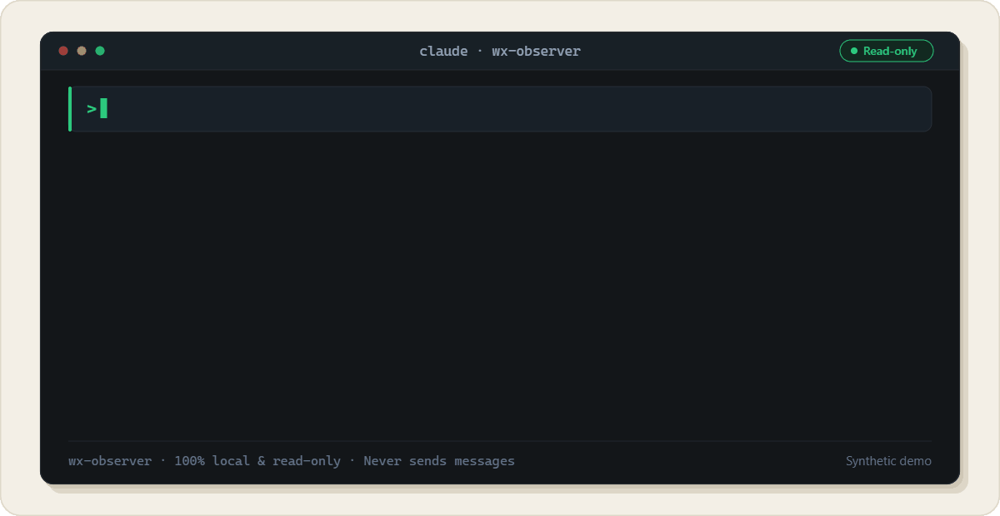

<p align="center">
  <picture>
    <source media="(prefers-color-scheme: dark)" srcset="./assets/readme/logo-dark.svg">
    
  </picture>
</p>

<h1 align="center">wx-observer</h1>

<p align="center">
  Give Claude, Cursor, and Codex read-only memory of your WeChat.
</p>

<p align="center">
  <strong>English</strong> · <a href="./README.zh-CN.md">简体中文</a> &nbsp;|&nbsp;
  <a href="#just-ask">Just Ask</a> ·
  <a href="#1-line-setup">1-Line Setup</a> ·
  <a href="./docs/en/guide.md">Docs</a>
</p>

<p align="center">
  <picture>
    <source media="(prefers-color-scheme: dark)" srcset="./assets/readme/demo-en-dark.gif">
    
  </picture>
</p>

<p align="center">
  <sub>Synthetic demo showing natural-language WeChat recall in an AI terminal. Prefer a still image? View the <a href="./assets/readme/demo-en.svg">static SVG</a>.</sub>
</p>

## Just Ask

Once connected to your AI assistant, simply talk to it in plain language — no commands to memorize:

- *"Summarize what the product and design groups decided yesterday."* — [`wx-brief`](skills/wx-brief/SKILL.md)
- *"Find the quote PDF Chen sent last week and summarize the pricing."* — [`wx-find`](skills/wx-find/SKILL.md)
- *"List everything where someone @mentioned me or gave me a deadline."* — [`wx-todo`](skills/wx-todo/SKILL.md)
- *"Watch these two project groups and alert me when something urgent arrives."* — [`wx-watch`](skills/wx-watch/SKILL.md)

## 1-Line Setup

Works on **Windows 10 / 11 (64-bit)** alongside desktop **WeChat 4.x** and any MCP-capable AI client. Paste this prompt directly to your AI assistant and let it handle installation:

```text
Install wx-observer from https://github.com/liyifu-2026/we-observer, configure its MCP server for this client, and install its 4 built-in skills.
```

Want manual setup, CLI commands, or tool details? See the [Usage Guide](docs/en/guide.md).

## Safe by Design

- **Strictly Read-Only** — Never sends messages, never automates or clicks WeChat windows, and never modifies your WeChat files.
- **Content Is Data** — Message text, filenames, link titles, and quoted replies are treated strictly as untrusted data, never as instructions; compact outputs defuse Markdown links so URLs are never auto-fetched.
- **100% Local & Audited** — Runs locally with zero cloud upload, logs read metadata (with SHA-256 hashed chat IDs) to `audit.jsonl`, and supports `--no-key-cache` for memory-only key handling.
- **Open & Auditable** — Full architecture, DPAPI trust boundary, and local file scope live in [Architecture & Boundaries](docs/en/architecture.md).

---

<p align="center">
  <sub>For personal local backup and learning use only · <a href="./LICENSE">MIT License</a></sub>
</p>
