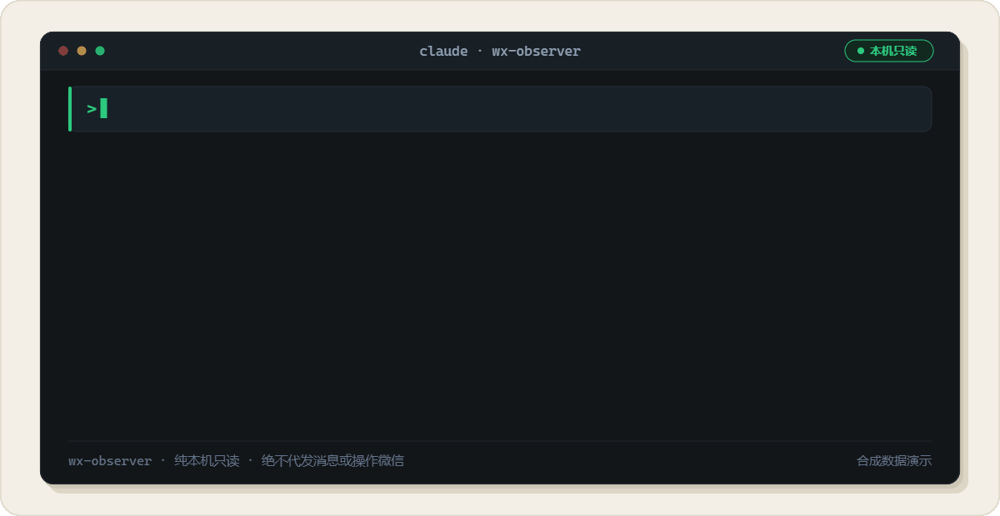

<p align="center">
  <picture>
    <source media="(prefers-color-scheme: dark)" srcset="./assets/readme/logo-dark.svg">
    
  </picture>
</p>

<h1 align="center">wx-observer</h1>

<p align="center">
  让 Claude、Cursor 与 Codex 安全、只读地记住你的微信。
</p>

<p align="center">
  <a href="./README.md">English</a> · <strong>简体中文</strong> &nbsp;|&nbsp;
  <a href="#装完后直接提问">直接提问</a> ·
  <a href="#一句话安装">一句话安装</a> ·
  <a href="./docs/zh-CN/guide.md">详细文档</a>
</p>

<p align="center">
  <picture>
    <source media="(prefers-color-scheme: dark)" srcset="./assets/readme/demo-zh-dark.gif">
    
  </picture>
</p>

<p align="center">
  <sub>以上为合成数据演示：直接用自然语言让 AI 总结群聊并找回本地文件。仅需静态预览可看 <a href="./assets/readme/demo-zh.svg">静态 SVG 版本</a>。</sub>
</p>

## 装完后直接提问

连上你的 AI 助手后，不用记任何命令，像平时一样直接吩咐它就行：

- *“帮我总结昨天产品群和设计群拍板了哪些事？”* — [`wx-brief`](skills/wx-brief/SKILL.md)
- *“找一下陈上周发过的报价单 PDF，顺便把价格表总结给我。”* — [`wx-find`](skills/wx-find/SKILL.md)
- *“把最近所有 `@我` 的请求和带截止时间的事列出来。”* — [`wx-todo`](skills/wx-todo/SKILL.md)
- *“帮我盯着这两个项目群，有紧急消息立刻提醒我。”* — [`wx-watch`](skills/wx-watch/SKILL.md)

## 一句话安装

支持 **64 位 Windows 10 / 11**、桌面版**微信 4.x** 及支持 MCP 的 AI 客户端。直接把下面这句话发给你的 AI 助手即可全自动配好：

```text
帮我从 https://github.com/liyifu-2026/we-observer 安装 wx-observer，配置好 MCP 服务并装上内置的 4 个 Skills。
```

需要手动安装步骤或查看全部 CLI 命令，请看[使用指南](docs/zh-CN/guide.md)。

## v0.4.0 新特性

- **开箱自检与配置生成** — `wx-observer verify` 核验核心分片解密（可选 `*_fts.db` 失败时降级告警而不误报阻塞），`wx-observer doctor --bundle doctor.zip` 生成脱敏诊断包，`wx-observer mcp --print-config <client>` 直接输出各客户端可粘贴配置。
- **转发聊天记录展开** — 新增 `expand_chat_history` MCP 工具展开嵌套转发记录（默认 `limit=20`，`0` 展开全部），并与 `list_attachments` 统一内嵌文件本地路径与 `next_action` 语义。
- **更完善的身份、摘要与审计** — 补齐本机 `self` 与 `top_senders[].is_self`、450 字 `head_tail` 截断、带年份的 `ts_iso`、`search_messages` 多群作用域、`audit.jsonl` 与 `--no-key-cache`。详见 [CHANGELOG.md](./CHANGELOG.md)。

## 为什么可以放心用

- **绝对只读** — 绝不代发消息、绝不模拟键鼠或操控微信窗口，也不会改动微信自己的任何文件。
- **内容即数据** — 群消息正文、文件名、链接标题与引用内容一律视作不可信第三方数据，绝不当作指令执行；紧凑输出会自动拆断可点击 Markdown 链接（`](http` -> `] (http`），裸 `https://` 文本由 MCP `instructions` 约束禁止自动抓取。
- **纯本地且可追溯** — 零联网上传，每次读取写入脱敏审计日志 `audit.jsonl`（会话 ID 经 SHA-256 截断），并支持 `--no-key-cache` 纯内存取密。
- **开源可审计** — 完整技术原理、DPAPI 信任边界与本机文件范围见[工作原理与安全边界](docs/zh-CN/architecture.md)。

---

<p align="center">
  <sub>仅供个人本机数据备份参考与技术学习研究 · <a href="./LICENSE">MIT License</a></sub>
</p>
