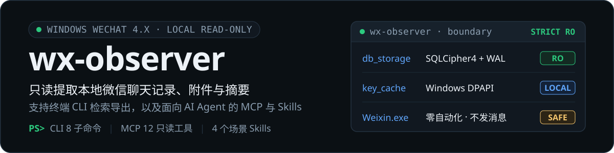
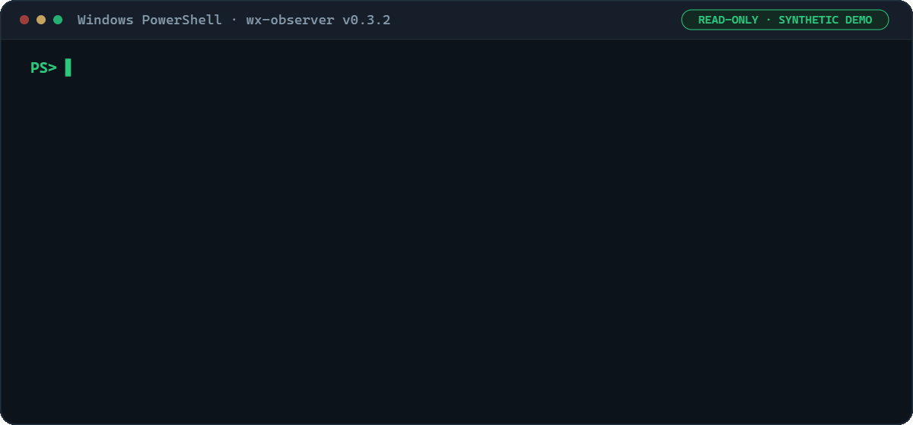

<p align="center">
  
</p>

<p align="center">
  <a href="./README.md">English</a> · <strong>简体中文</strong> &nbsp;|&nbsp;
  <a href="#终端演示">终端演示</a> ·
  <a href="#快速开始">快速开始</a> ·
  <a href="./docs/zh-CN/guide.md">详细文档</a> ·
  <a href="./docs/zh-CN/architecture.md">工作原理</a>
</p>

面向 **Windows 微信 4.x（`Weixin.exe`）** 的纯只读本地聊天记录提取与实时观察工具。人可在终端检索与导出对话；AI Agent 可通过 MCP 只读工具与场景化 Skills 直接获取压缩摘要、本地附件与实时增量消息。

## 终端演示

<p align="center">
  
</p>

<p align="center">
  <sub>以上使用合成数据依次演示跨会话摘要与本地文件核验（<code>digest</code>）、带引用紧凑搜索（<code>search --compact</code>）以及 MCP 服务启动（<code>mcp</code>）。也可查看 <a href="./assets/readme/terminal-demo.svg">静态 SVG 版本</a>。</sub>
</p>

## 核心特性

- **严格只读边界** — 借助 Windows DPAPI 密钥缓存与隔离 `-wal` 快照读取本地 SQLCipher4 数据库，不发消息、不操作微信窗口、不注入目标进程。
- **终端检索与多格式导出** — 跨分片查询历史与转发记录附件（核验本机 `local_path`），支持导出为 Markdown、CSV、JSON 或 JSONL。
- **Agent 原生 MCP 接口** — 通过可选 `[mcp]` 依赖提供 12 个只读工具（`stdio` / 本机 HTTP），内置 token 预算裁剪与幂等 `peek`/`ack` 增量游标。
- **内置 4 个场景 Skills** — 位于 [`skills/`](skills/)：[`wx-brief`](skills/wx-brief/SKILL.md)、[`wx-find`](skills/wx-find/SKILL.md)、[`wx-todo`](skills/wx-todo/SKILL.md) 与 [`wx-watch`](skills/wx-watch/SKILL.md)。

## 快速开始

需 **64 位 Windows 10 / 11**、**64 位 Python 3.11+** 及桌面版**微信 4.x（`Weixin.exe`）**，且与当前用户权限级别一致：

```powershell
python -m venv .venv
.\.venv\Scripts\python.exe -m pip install -e .
.\.venv\Scripts\wx-observer.exe --help
```

如需启用 MCP Server，执行 `.\.venv\Scripts\python.exe -m pip install -e ".[mcp]"` 即可。

## 详细文档

| 文档 | 内容说明 |
| --- | --- |
| [使用指南](docs/zh-CN/guide.md) | 完整安装与离线试用、CLI 全命令参考、MCP `stdio`/HTTP 配置与 12 个工具默认行为、Skills 部署 |
| [工作原理与安全边界](docs/zh-CN/architecture.md) | Mermaid 调用序列图、DPAPI/WAL 隔离机制、本机文件落地范围与只读声明 |

## 许可与声明

本项目仅供个人本机数据备份参考与技术学习研究，使用边界与免责条款见[工作原理与安全边界](docs/zh-CN/architecture.md)。代码基于 [MIT License](LICENSE) 开源。
