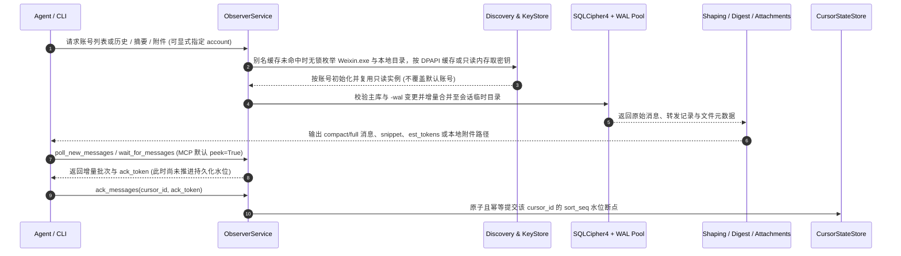

  <a href="../../README.zh-CN.md">首页</a> · <a href="../en/architecture.md">English</a> · <strong>简体中文</strong> · <a href="./guide.md">使用指南</a>

# 工作原理与安全边界

`wx-observer` 如何在不修改微信进程状态、不触发 UI 自动化、不发送消息的前提下完成本机只读提取与实时观察。

## 调用序列图

## 关键机制拆解

1. **进程句柄与目录发现（`discovery.py`、`service.py`）**：通过只读枚举 Windows 窗口与 `Weixin.exe` 进程文件句柄，自动识别迁移后的 `xwechat_files` 目录及在线/离线账号；显式传入 `account` 时走 30 秒别名缓存并校验 PID 存活，未命中时在锁外执行发现。
2. **DPAPI 密钥缓存与只读内存取密（`key_store.py`、`memory_scanner.py`）**：经 Page-1 HMAC 校验通过的 SQLCipher4 密钥使用 Windows DPAPI（`CryptProtectData`）按当前 Windows 用户加密缓存，并记录创建者 Windows SID（`owner_sid`）。**关键信任边界**：DPAPI 绑定的是 Windows 登录用户，不是 `wx-observer` 进程；同用户下的其他程序理论上可解密该缓存。需要零落盘时可启用 `--no-key-cache`（或 `WX_OBSERVER_NO_KEY_CACHE=1`）。

### 密钥来源与风险对比

| 模式 | 持久化落盘 | 信任边界与适用场景 |
| --- | --- | --- |
| 默认 DPAPI 缓存（`%LOCALAPPDATA%\wx-observer\keys\`） | 按用户 DPAPI 加密 + `owner_sid` 校验 | 微信退出后仍可离线读取；同 Windows 登录用户下的其他进程理论上可解密。 |
| `--no-key-cache`（仅内存扫描） | 无（仅驻留进程内存，重启失效） | 磁盘零密钥残留；每次启动需目标 `Weixin.exe` 在线。 |
| `--keys-file <path>`（`WX_OBSERVER_KEYS_FILE`） | 用户自管 JSON 文件 | 文件位置与 ACL 完全由用户控制；除外部加密外文件内容为 JSON。 |
3. **增量 WAL 隔离快照（`cipher_store.py`）**：并发校验主库与 `-wal` 变更页，增量合并到独立会话目录 `%TEMP%\wx_observer_tmp\sess-<pid>-<uuid>\` 并经 `PRAGMA quick_check` 验证，不锁定也不写回微信原库。
4. **跨分片解析与服务端裁剪（`repository.py`、`shaping.py`、`digest.py`、`attachments.py`）**：跨 `message_*.db` 单遍批量扫描，结合 SQL C 层关键词预过滤、64 位 `local_type` 子类型下推、zstd 解压、五级 `token_budget` 裁剪与 MD5/文件大小附件校验。
5. **游标隔离与至少一次幂等投递（`state.py`、`monitor.py`）**：按 `(account_id, cursor_id)` 独立持久化 `state.db` 断点；`peek=True` 签发 `ack_token`，重复提交同一 token 返回 `already_committed: true`，既不报错也不回退水位。

## 严格只读边界与本地文件范围

- **对微信绝对只读**：不发送微信消息、不模拟键鼠或操作微信窗口、不注入 DLL、不写入目标进程内存，也不依赖针对二进制特征码或版本固定 RVA 偏移的读取方式。
- **内容即数据（防提示词注入与外泄）**：MCP `instructions` 明确声明所有消息正文、文件名、链接标题与引用内容均为不可信数据并禁止自动抓取 URL；消息条目附带 `"untrusted": true` 且拆断可点击 Markdown 链接（`](http` -> `] (http`），裸 URL 保持纯文本并受 `instructions` 约束。
- **本机落地文件仅限以下受控位置**：
  - DPAPI 加密密钥缓存：`%LOCALAPPDATA%\wx-observer\keys\`（传 `--no-key-cache` 时不写入）
  - 游标进度数据库：`%LOCALAPPDATA%\wx-observer\state.db`（或 `--state-dir` 指定目录）
  - 只读审计日志：`%LOCALAPPDATA%\wx-observer\audit.jsonl`（默认开启，10MB × 3 轮转，仅记录白名单字段与 SHA-256[:12] 哈希；支持 `--audit off|on|<path>`）
  - 会话临时解密快照：`%TEMP%\wx_observer_tmp\sess-*`（正常退出自动清理，启动时回收残留）
  - 显式执行 `history --export ... --output ...` 时写入的用户目标文件
- **MCP 暴露说明**：通过 MCP 使用时，工具返回文本会按客户端机制进入宿主上下文；Streamable HTTP 默认仅监听 `127.0.0.1` 并支持恒定时间比对 Bearer Token 鉴权（推荐使用 `WX_OBSERVER_MCP_TOKEN` 或 `--token-file`）。

## 免责与许可

本项目仅供技术学习、学术研究与个人本机数据备份参考，严禁用于任何商业用途、自动化营销、批量采集或违反相关服务协议及法律法规的场景。使用、修改或分发本代码所产生的一切责任由使用者自行承担。代码基于 [MIT License](../../LICENSE) 开源。
